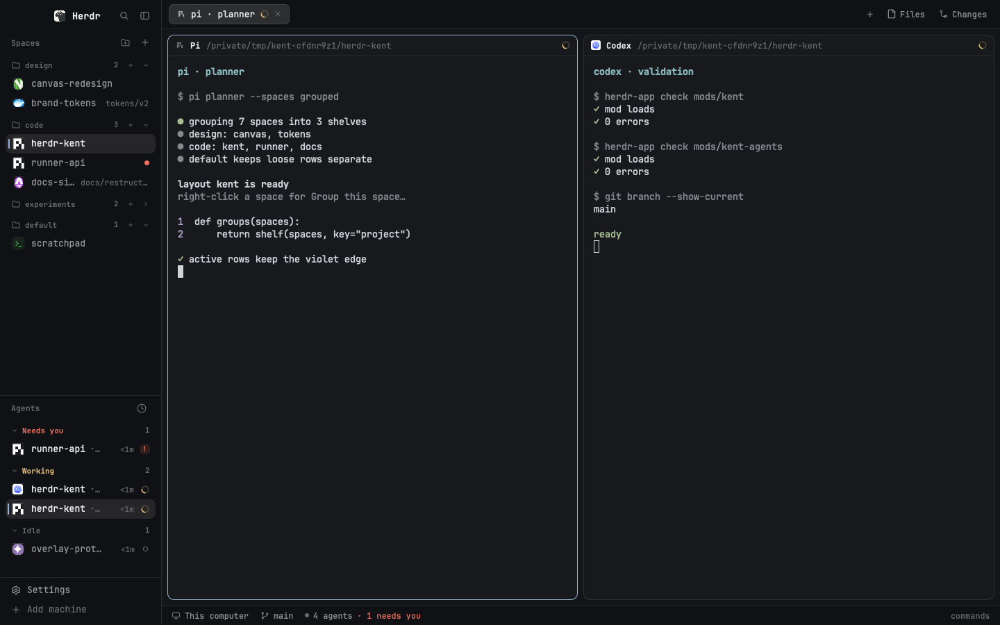

# Kent for Herdr

[中文说明](README.zh-CN.md)

Kent is a Herdr layout for people who keep many spaces open. It keeps Herdr's practical main window, but turns the Spaces sidebar into named, foldable groups inside each machine.



## What it does

- Groups spaces under named labels such as `design`, `code`, or `experiments`; unassigned spaces stay in `default`, under a foldable heading of their own once named groups are in use.
- Groups are scoped to each machine; remote and local spaces are never mixed.
- Group headers fold and unfold, show member counts, and keep the shape of the work visible while folded: a working count with a spinner, a red `!n` blocked count, and a quiet `●n` done count. Unfolded groups stay quiet; their rows say the same thing.
- A small red `!n` beside `Spaces` is the whole window's needs-you count: agents blocked across every machine and group. Click it to jump to the first one. It uses Herdr's own status, so a `done` that becomes `idle` after you look at it behaves the same here.
- The search button under `Spaces` (or the palette's **Filter spaces**) narrows the list by space name, machine, git repo, branch, or folder. A group-name match shows the whole group; counts read `matched/total`; `↑`/`↓` move the highlight, `Enter` opens it, and `Esc` clears it. The filter changes what is drawn, never Herdr's real space order.
- Space rows show program icons in theme-aware contrast-edge chips, plus the space name, git repository/branch details, and agent status. Shipped SVG icons are fitted from their visible vector bounds, so tall or wide artwork keeps its direction instead of being stretched into squares. A name that doesn't fit shows its full name in a tooltip, as does every row of the compact rail.
- The name keeps its width while it fits: the git tail is what narrows, and it is left out when only a stub of it would fit. A long name is cut in the middle, so its telling end stays visible.
- Agents use the same icon chips and name tooltips through the included `kent-agents` mod, cut a long name in the middle, and keep a distinguishing detail when two agents on the same machine would otherwise read the same. You can sort them by priority, by space, or by machine. Sub-agent and group folds persist across restarts. Clicking an agent also brings its machine into view in the Spaces list.
- A machine that still has agents, or a Parked folder, is listed under its own header even when it has no open space. Temporary (`--temp`) sandboxes stay hidden, as in Herdr. If that machine has no open space, the list says how many agents are there: click to open one, or use the header `+` to make a new space.
- Once a machine's header has scrolled out of the list, its name stays beside `Spaces` until you scroll back; click it to bring the header back.
- Both lists show their scrollbar only while you are in them or scrolling.
- Spaces can be created directly inside a group, assigned from the right-click menu, or dragged onto a group header. A new space from the header or a group's `+` lands directly below the active space when it is in that same group, instead of at the end of the group.
- Spaces can be reordered inside a group, dragged between groups, or moved back to `default`.
- Close the active space and Kent selects the visible row just above it, rather than whatever Herdr picks next. Closed spaces leave a **Parked** drawer at the bottom of their machine: folder, name, and old group are remembered; click a row to reopen the folder as a new space, or `×` to forget it. A folder that is already open is not shown again.
- Machine folding/reconnection, git details and the narrow numbered rail come from Herdr's `spaces` mod. Worktree nesting is Herdr's in `default`; inside a named group Kent draws the tree, and a worktree nests only while it sits directly under its main checkout there. Worktree rows are joined by a quiet vertical/corner line instead of a text glyph, so the family reads at a glance without pushing the icon out of the row.
- The compact narrow-sidebar rail still works when the sidebar is very small. Its numbers are each row's place in the list as drawn, and the optional `ctrl-1` … `ctrl-9` keys select by them.

## Install

### From the Herdr Gallery

Open:

<https://herdr.dev/layouts/bioShaun/herdr-kent>

### Manual install

```sh
git clone https://github.com/bioShaun/herdr-kent.git
# SSH instead: git clone git@github.com:bioShaun/herdr-kent.git
cd herdr-kent
scripts/install.sh
```

`scripts/install.sh` copies the layout and its three mods into `~/.config/herdr-app` — or into `$HERDR_APP_HOME` when that is set, or into the directory given as its argument — keeps a copy of every file it replaces in `<herdr-home>/kent-backup-<time>/`, and runs `herdr-app check` on the installed mods. It also installs `manifest.json` as `kent-version.json`, the updater's version marker. It does not touch `keys.json`.

The same files by hand (a custom `HERDR_APP_HOME` replaces `~/.config/herdr-app`):

```sh
cp layouts/kent.json layouts/kent.svg ~/.config/herdr-app/layouts/
mkdir -p ~/.config/herdr-app/mods/kent ~/.config/herdr-app/mods/kent-agents ~/.config/herdr-app/mods/kent-updater
cp mods/kent/main.js mods/kent/mod.json mods/kent/icon-chip.js mods/kent/icon-metrics.js mods/kent/update-check.js ~/.config/herdr-app/mods/kent/
cp mods/kent-agents/main.js mods/kent-agents/mod.json mods/kent-agents/icon-chip.js mods/kent-agents/icon-metrics.js ~/.config/herdr-app/mods/kent-agents/
cp mods/kent-updater/main.js mods/kent-updater/mod.json mods/kent-updater/core.js mods/kent-updater/updater.js ~/.config/herdr-app/mods/kent-updater/
cp manifest.json ~/.config/herdr-app/kent-version.json

herdr-app check ~/.config/herdr-app/mods/kent
herdr-app check ~/.config/herdr-app/mods/kent-agents
herdr-app check ~/.config/herdr-app/mods/kent-updater
```

Then show the layout:

```sh
herdr-app do layout.switch '{"name":"kent"}'
```

Your existing `main` layout is not modified. Use `ctrl-shift-l` / `cmd-shift-l` to cycle layouts, or run:

```sh
herdr-app do layout.switch '{"name":"main"}'
```

## Update

Herdr installs a shared layout as a plain copy, so Kent carries a small updater of its own instead of waiting for the Gallery to push one.

- **Check.** `mods/kent-updater` reads `manifest.json` on this repository's `main` branch at start and every six hours. A new version shows as a violet `↑ 1.2.3` chip beside `Spaces`, a toast, and the palette entry **Check for Kent updates**.
- **Install.** **Update now** downloads every file the manifest names, checks its SHA-256 and size, stages the mod files in a throwaway Herdr home, runs `herdr-app check` on both staged mods, backs up the installed files to `<herdr-home>/kent-backup-<time>/`, and only then writes. A failed step rolls the written files back; `kent-version.json` is written last, so an interrupted update keeps asking to be retried instead of claiming it is current.
- **Scope.** It overwrites `layouts/kent.json`, `layouts/kent.svg`, `mods/kent` and `mods/kent-agents`. `mods/kent-updater` is the bootstrap and is never updated; `keys.json`, other layouts and other mods are untouched. Your edits to the managed files are overwritten: keep them in a clone (`herdr-app do layout.clone '{"name":"kent","as":"my-kent"}'`) or a fork.
- **Network.** Only GitHub is contacted: one commit lookup and one small manifest at each check, then the changed files when you press Update. Nothing about you is sent. Every downloaded file is verified against the manifest, but the manifest itself is not signed; install only if you trust this repository.
- **Releasing.** Raise `version` and `notes`, then run `python3 scripts/build-manifest.py --version X.Y.Z --notes "what changed"` and commit `manifest.json`. CI runs `python3 scripts/build-manifest.py --check` and fails when the manifest is stale.

## Optional keys

`keys.json` contains optional bindings. Do not replace your whole Herdr `keys.json`; merge the `layout:kent` section into it manually:

```json
{
  "layout:kent": {
    "alt-down": "agent.next",
    "alt-up": "agent.prev",
    "alt-1": "agent.select:1",
    "alt-2": "agent.select:2",
    "alt-3": "agent.select:3",
    "alt-4": "agent.select:4",
    "alt-5": "agent.select:5",
    "alt-6": "agent.select:6",
    "alt-7": "agent.select:7",
    "alt-8": "agent.select:8",
    "alt-9": "agent.select:9",
    "ctrl-1": "kent.select1",
    "ctrl-2": "kent.select2",
    "ctrl-3": "kent.select3",
    "ctrl-4": "kent.select4",
    "ctrl-5": "kent.select5",
    "ctrl-6": "kent.select6",
    "ctrl-7": "kent.select7",
    "ctrl-8": "kent.select8",
    "ctrl-9": "kent.select9",
    "ctrl-shift-pagedown": "kent.next",
    "ctrl-shift-pageup": "kent.prev"
  }
}
```

`alt-up` / `alt-down` keep Herdr's agent previous/next, and `alt-1` … `alt-9` use Herdr 0.1.18's `agent.select` to jump to the Nth agent in the list as Kent draws it. Space movement stays on `ctrl-shift-pageup` / `ctrl-shift-pagedown` (`kent.prev` / `kent.next`), which follow the order Kent draws, skip rows hidden inside folded groups, and follow an active filter. `ctrl-1` … `ctrl-9` select the Nth space row as the sidebar shows it, the number the narrow rail prints; they are not used for agents. Herdr's own `ctrl-N` goes by its internal space order, which parts ways with the list once groups and worktree nesting reorder rows; the `layout:kent` section wins over `global` while Kent is shown. Already merged an older `layout:kent` section? Restore `alt-up` / `alt-down` to `agent.prev` / `agent.next`, add the `alt-N` lines, and keep the nine `ctrl-N` space bindings.

## Using groups

- Right-click a space to open its menu.
- Choose `Group this space…` to create a group containing that space.
- Choose `Move to …` to file the space under an existing group.
- Choose `Move to default` to move it back to the default group.
- Drag a space onto a group header to append it to that group.
- Drag a space over another row to reorder it.
- Hold a dragged space near the top or bottom edge of the list and the list scrolls that way, so a group that is out of sight can be dropped on.
- While dragging a grouped space, use `Move to default` at the bottom of the list to remove it from its named group.
- Click a group header to fold or unfold it; use its `+` button to create a new space inside that group. The `+` puts the new row under the active space when that space already belongs to the group.
- Right-click a named group header to create a space in it, rename, reorder, fold/unfold, or delete it. Deleting a group never closes its spaces.
- Use the search button, **Filter spaces** in the palette, or the `kent.filter` command to filter. `↑`/`↓` move the filter highlight; `Enter` opens the highlighted space; `Esc` clears the query and closes the filter. Number keys and `ctrl-shift-pageup` / `ctrl-shift-pagedown` follow the filtered space list too.
- Close a space and it moves to that machine's **Parked** section. Click a Parked row to reopen its folder in the group it came from (or `default` if that group is gone). The `×` on the row forgets it; Parked travels with the machine's document, so another client on the same machine sees the same drawer.

On git checkouts, the space menu also includes Herdr's worktree actions: `New worktree`, `Open worktree`, and, for linked checkouts, `Remove worktree`.

## Theme behavior

Kent does not hardcode a light or dark theme. It follows `settings.json`, the system appearance, and Herdr's theme picker. Changing appearance or theme should redraw both Spaces and Agents; the icon edge colors invert with the active appearance.

## Notes and limits

- Grouping is manual. Kent does not infer groups from path, prefix, or tags.
- Groups cannot span machines. Same-named groups on two machines are independent.
- Group state and the machine's Parked drawer are stored per machine in that machine's herdr-core document `kent.groups.v1`. Clients connected to the same machine share group definitions, membership, ordering, fold state, and parked folders, even when they use different local aliases for that machine; membership is stored as machine-local space ids.
- Writes are optimistic in the window and then written asynchronously with the core document's compare-and-set version. A conflict is reread and the intent is reapplied rather than blindly overwriting the other client's edit. On herdr-core 0.1.22 and newer, Kent subscribes to `kent.groups.v1` with `hc events --doc` and refreshes when that document changes; it still polls every few seconds as a fallback, and on older cores that is the only path. Another client's change can take a few seconds to appear when falling back to the poll.
- If a machine is offline or its core is too old for document storage, Kent keeps the previous client-local behavior and queues edits locally. Queued intents survive app restarts and retry when the machine and core are available; until then those edits are not visible to other clients.
- Existing client-local groups and Parked folders are migrated once into each machine document. Same-named legacy groups are merged because the old local-only data did not have stable cross-client identities; membership already present in the machine document wins. If several clients had divergent arrangements, review important groups after the first synchronized migration.
- Parked projects live in the machine's `kent.groups.v1` document (capped at 50 per machine), with `kent.projects.v1` kept as a local copy and as the migration fallback for older cores. They remember the folder, display name, and old group only — not tabs, scrollback, or the exact process. Reopening a folder creates a new space rather than restoring the old session.
- The folded group counts and the needs-you badge rely on Herdr's `done`/`idle` and space status. Kent does not invent an unread table: once any Herdr client looks at a finished agent, `done` becomes `idle` everywhere and the count drops.
- Filtering is a view, not a reorder. It never passes a filtered subset to `ordered()`/`space.move`; clearing the query restores the full list in its original group order.
- Ordering inside named groups belongs to Kent. Spaces in `default` continue to use Herdr's own ordering.
- Kent was built and tested against Herdr 0.1.18. Cross-client group and Parked synchronization requires a herdr-core new enough for machine-scoped documents (validated with 0.1.22); older cores use the client-local fallback.
- Visible-bound metrics are generated for the SVG icons shipped with Herdr 0.1.18. Icons added by a future Herdr version can be measured again with `scripts/generate-icon-metrics.py`; unknown custom icons fall back to square fitting.

## Development

The Spaces mod is in `mods/kent/main.js`; the Agents variant is in `mods/kent-agents/main.js`; the layout tree is `layouts/kent.json`.

Validate the mod from the repository root:

```sh
herdr-app check mods/kent
herdr-app check mods/kent-agents
```

Run the group synchronization unit harness, optionally with an isolated real-core document/CAS test (it uses a temporary `HC_SESSION` and does not touch the default core):

```sh
node scripts/test-group-sync.js
node scripts/test-group-sync.js --core
```

The drag checks need the real pointer, since a mod only sees real mouse events. With Accessibility permission for **Herdr Core**, `tests/hid-drag.py` posts HID-level events (the cursor really moves, the button really goes down) and reads the result back from `herdr-app shot`. `scan-edge` puts the list back at the top, then holds a dragged row at each y it is given and reports whether rows moved - the regression check for the drag-to-scroll band:

```sh
uv run --with pyobjc-framework-Quartz --with pillow python tests/hid-drag.py scan-edge
```

It moves your real cursor and presses the real button; coordinates and options are in the script's header. It uses `HERDR_APP_HOME` (or `--home`) for the home, and refuses to guess when more than one Herdr window is visible: pass `--window-id`, or close all but one. A chosen window must be brought to the front first.

Both mods keep their own copy of `icon-chip.js` and `icon-metrics.js`. After editing either copy, verify the pairs still match (and both mods still load) with the following command. Its `herdr-app check` runs use a temporary isolated app home/core session and check a copy of each mod, so they neither disturb the running default Herdr core nor generate editor files in the repository:

```sh
python3 scripts/check.py
```

After Herdr updates its shipped icon set, regenerate the icon metrics from the repository root:

```sh
uv run --with svgpathtools python scripts/generate-icon-metrics.py
```

After changing the layout or mods, regenerate the preview from the repository root:

```sh
uv run --with pillow python scripts/generate-preview.py
```

The script starts a temporary isolated Herdr home/core, seeds curated demo spaces and agents, captures a real rendered frame with `herdr-app shot`, writes `preview.png`, and removes the temporary instance. It does not read or capture your normal Herdr home. Use `--font` to override the preview font (default `JetBrainsMono Nerd Font Mono`), `--keep` to keep the isolated directory for debugging, or `--output` to write another file.

The settings-picker thumbnail is separate: `layouts/kent.svg`, referenced by the layout's `preview` field, is a hand-drawn 320×200 schematic in the sparse built-in thumbnail style, with the grouped sidebar as the hero — violet folder group headers, indented members, a folded group keeping working, blocked, and done counts, and a quiet work area. A full screenshot turns to mush at card size. Update it by hand when the layout structure changes.

`SPEC.md` is the historical design record for the review that produced this layout; current behavior is described here and in `RECIPE.md`.
`RECIPE.md` is the detailed implementation brief used for the Herdr Gallery format.

## License

Apache License 2.0. Kent includes derivatives of Herdr's shipped `spaces` and `agents` mods; see `NOTICE`.
