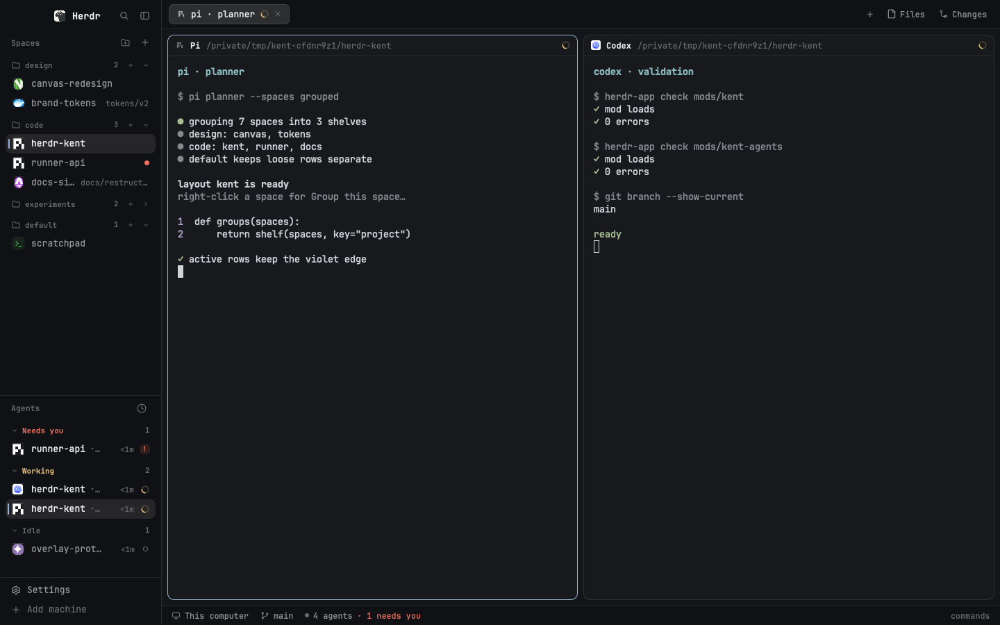

# Kent for Herdr

[English README](README.md)

Kent 是一个适合同时打开很多 spaces 的 Herdr layout。它保留 Herdr 主窗口的实用结构，同时把 Spaces 侧栏变成按机器划分的命名分组列表。



## 功能

- 可以把 spaces 放入 `设计`、`代码`、`实验` 等命名分组；未归组的 spaces 留在 `default`，一旦使用命名分组，它们会有自己的可折叠标题。
- 分组按机器隔离；本机和远程机器的 spaces 不会混在一起。
- 分组标题可以折叠/展开，显示成员数量；折叠后仍会显示 blocked/done 状态。
- space 行使用带主题感知对比边缘的 program icon chip，并显示名称、git 仓库/分支信息和 agent 状态；内置 SVG icon 会按可见矢量边界适配，因此竖向或横向图形都能保持自己的方向，不再被拉成方形。名称显示不全时（以及窄栏编号模式下），悬停可以看到完整名称。
- 名称优先：放得下就保持完整，让 git 尾巴让位；尾巴只剩几个字母时直接不显示。长名称从中间省略，保留更有辨识度的结尾。
- Agents 列表通过内置的 `kent-agents` mod 使用同一套 icon chip 和名称 tooltip；space 名后面的细节在只剩残片时干脆不显示。
- 某台机器的标题滚出列表后，它的名字会留在 `Spaces` 旁边，滚回去即消失；点一下可以回到该机器的标题。
- 两个列表的滚动条只在鼠标停留或滚动时出现。
- 可以直接在分组里新建 space，也可以通过右键菜单放入分组，或直接拖到分组标题上。
- 可以在组内排序、在分组之间拖动，也可以移回 `default` 组。
- 机器折叠/重连、git 信息和窄栏编号来自 Herdr 自带的 `spaces` mod。worktree 嵌套在 `default` 组沿用 Herdr 规则；在命名组里由 Kent 自己画树线，只有当 worktree 紧接在其 main checkout 之后时才会嵌套。
- 很窄的侧栏下仍然支持紧凑的编号 rail 模式。编号就是该行在列表里的位置，可选快捷键 `ctrl-1` … `ctrl-9` 按这个编号选择。

## 安装

### 从 Herdr Gallery 安装

等 Gallery 完成索引后，打开：

<https://herdr.dev/layouts/bioShaun/herdr-kent>

### 手动安装

```sh
git clone git@github.com:bioShaun/herdr-kent.git
cd herdr-kent
scripts/install.sh
```

`scripts/install.sh` 会把 layout 和两个 mod 复制到 `~/.config/herdr-app`（设置了 `HERDR_APP_HOME` 就用它，也可以把目标目录作为参数传入），被替换的文件先备份到 `<herdr-home>/kent-backup-<时间>/`，然后对装好的 mod 运行 `herdr-app check`。它不会动 `keys.json`。

也可以手动复制同样的文件（使用自定义 `HERDR_APP_HOME` 时，把 `~/.config/herdr-app` 换成你的目录）：

```sh
cp layouts/kent.json layouts/kent.svg ~/.config/herdr-app/layouts/
mkdir -p ~/.config/herdr-app/mods/kent ~/.config/herdr-app/mods/kent-agents
cp mods/kent/main.js mods/kent/mod.json mods/kent/icon-chip.js mods/kent/icon-metrics.js ~/.config/herdr-app/mods/kent/
cp mods/kent-agents/main.js mods/kent-agents/mod.json mods/kent-agents/icon-chip.js mods/kent-agents/icon-metrics.js ~/.config/herdr-app/mods/kent-agents/

herdr-app check ~/.config/herdr-app/mods/kent
herdr-app check ~/.config/herdr-app/mods/kent-agents
```

然后切换到这个 layout：

```sh
herdr-app do layout.switch '{"name":"kent"}'
```

这个安装不会修改原有的 `main` layout。可以用 `ctrl-shift-l` / `cmd-shift-l` 循环切换 layout，也可以手动切回：

```sh
herdr-app do layout.switch '{"name":"main"}'
```

## 可选快捷键

仓库里的 `keys.json` 是可选绑定。不要用它完整覆盖你的 Herdr `keys.json`；只需要把其中的 `layout:kent` section 合并进去：

```json
{
  "layout:kent": {
    "alt-down": "kent.next",
    "alt-up": "kent.prev",
    "ctrl-1": "kent.select1",
    "ctrl-2": "kent.select2",
    "ctrl-3": "kent.select3",
    "ctrl-4": "kent.select4",
    "ctrl-5": "kent.select5",
    "ctrl-6": "kent.select6",
    "ctrl-7": "kent.select7",
    "ctrl-8": "kent.select8",
    "ctrl-9": "kent.select9",
    "ctrl-shift-pagedown": "kent.next",
    "ctrl-shift-pageup": "kent.prev"
  }
}
```

第一组快捷键按照 Kent 实际显示的顺序切换 spaces，并跳过折叠分组里隐藏的行。`ctrl-1` … `ctrl-9` 选中侧栏里第 N 行，也就是窄栏编号打印的那个数字。Herdr 自带的 `ctrl-N` 按它内部的 space 顺序选择，一旦分组和 worktree 嵌套打乱了行序，两者就会对不上；Kent 显示期间 `layout:kent` 的优先级高于 `global`。之前合并过旧版 `layout:kent` 的话，把这九行 `ctrl-N` 补进去即可。

## 使用分组

- 右键一个 space 打开菜单。
- 选择 `Group this space…` 创建包含该空间的新分组。
- 选择 `Move to …` 移入已有分组。
- 选择 `Move to default` 移回 default 组。
- 把 space 拖到分组标题上，会加入该分组。
- 把 space 拖到另一行附近，可以调整顺序。
- 拖动时把 space 按在列表的上边缘或下边缘附近，列表会朝那个方向滚动，看不见的分组也能拖到。
- 拖动已分组 space 时，列表底部会出现 `Move to default`，拖到这里可以移出命名分组。
- 单击分组标题可以折叠或展开；使用标题上的 `+` 可以在该分组里新建 space。
- 右键命名分组标题可以在组内新建 space、重命名、上下移动、折叠/展开或删除分组。删除分组不会关闭其中的 spaces。

对于 git checkout，space 菜单还会显示 Herdr 的 worktree 操作：`New worktree`、`Open worktree`；linked worktree 还会显示 `Remove worktree`。

## 主题行为

Kent 不再写死亮色或暗色主题。它会跟随 `settings.json`、系统外观和 Herdr 的 theme picker。切换亮/暗 appearance 或主题时，Spaces 和 Agents 都会重绘，icon 边缘颜色也会随主题反转。

## 注意事项和限制

- 分组是手动维护的；Kent 不会根据路径、名称前缀或 tag 自动分组。
- 分组不能跨机器。两台机器上同名分组是相互独立的。
- 分组状态按机器保存在那台机器的 herdr-core document `kent.groups.v1` 里。连接到同一台机器的不同客户端会看到相同的分组、成员、顺序和折叠状态；即使各客户端给这台机器起了不同别名也没问题，因为成员关系保存的是机器本地 space id。
- 窗口里的修改会先即时显示，再异步写入 core document；写入使用版本号 CAS。发生并发冲突时会重新读取最新文档并把本次操作意图重新应用上去，而不是直接覆盖另一个客户端的修改。窗口可见时 Kent 大约每 3 秒轮询一次，因此其他客户端的修改可能需要几秒才会出现。
- 如果机器离线，或它的 core 太旧、不支持 document 存储，Kent 会退回到原来的客户端本地行为，并把修改保存在本地队列里。队列会跨 app 重启保留，并在机器/core 可用后重试；在同步成功前，这些修改对其他客户端不可见。
- 旧的客户端本地分组会在首次连接时迁移到对应机器的 document。由于旧数据没有跨客户端稳定身份，同名旧分组会被合并；machine document 中已有的成员关系优先。如果多台客户端以前的分组已经分叉，第一次同步迁移后建议检查重要分组。
- 命名组内排序由 Kent 管理；`default` 组里的 spaces 仍使用 Herdr 自己的排序。
- Kent 是基于 Herdr 0.1.18 开发和测试的。跨客户端分组同步需要支持 machine-scoped document 的 herdr-core（已用 0.1.22 验证）；较旧 core 会使用客户端本地 fallback。
- 可见边界数据目前覆盖 Herdr 0.1.18 自带的 SVG icon；未来 Herdr 新增 icon 后可以用 `scripts/generate-icon-metrics.py` 重新生成。未知自定义 icon 仍会退回方形适配。

## 开发

Spaces mod 源码在 `mods/kent/main.js`；Agents 变体在 `mods/kent-agents/main.js`；layout 树在 `layouts/kent.json`。

在仓库根目录验证 mod：

```sh
herdr-app check mods/kent
herdr-app check mods/kent-agents
```

运行分组同步单元测试；`--core` 还会用临时 `HC_SESSION` 做隔离的真实 core document/CAS 测试，不会碰默认 core：

```sh
node scripts/test-group-sync.js
node scripts/test-group-sync.js --core
```

拖拽相关的一小段只有真鼠标能验：mod 只收真实鼠标事件。给 **Herdr Core** 开辅助功能权限后，`tests/hid-drag.py` 用 HID 级事件真的移动光标、真的按下，再用 `herdr-app shot` 读结果。`scan-edge` 会先把列表滚回顶部，再把一个被拖住的行停在给定的每个 y 上，报告列表行有没有动——这是"贴边自动滚"触发带的回归检查：

```sh
uv run --with pyobjc-framework-Quartz --with pillow python tests/hid-drag.py scan-edge
```

它会移动你的真实光标并按下真实按键；坐标和其它选项见脚本头部注释。

两个 mod 各自保存一份 `icon-chip.js` 和 `icon-metrics.js`。修改任意一份后，用下面的命令校验两处副本仍然一致（且两个 mod 仍能加载）。脚本里的 `herdr-app check` 会使用临时隔离的 app home/core session，不会干扰正在运行的默认 Herdr core：

```sh
python3 scripts/check.py
```

Herdr 更新自带 icon 集后，可以在仓库根目录重新生成 icon 边界数据：

```sh
uv run --with svgpathtools python scripts/generate-icon-metrics.py
```

修改 layout 或 mods 后，可以在仓库根目录重新生成预览图：

```sh
uv run --with pillow python scripts/generate-preview.py
```

脚本会启动临时的隔离 Herdr home/core，布置策展好的 demo spaces 和 agents，用 `herdr-app shot` 截取真实渲染帧并写入 `preview.png`，结束后清理临时实例。它不会读取或截取你正常使用的 Herdr home。调试时可以使用 `--keep` 保留隔离目录，也可以用 `--output` 输出到其他文件。

设置页选择器的缩略图是独立维护的：layout 的 `preview` 字段指向 `layouts/kent.svg`，这是一张手绘的 320×200 示意图，沿用内置缩略图的极简风格，但让分组侧栏当主角——紫色文件夹组头、缩进成员行、保留红色状态点的折叠组，工作区退居背景。完整截图缩到卡片大小会糊成一团。布局结构变化时请手动更新这张示意图。

`RECIPE.md` 是按照 Herdr Gallery 格式编写的详细实现说明。

## License

Apache License 2.0。Kent 包含 Herdr 官方 `spaces` 和 `agents` mods 的衍生代码，详见 `NOTICE`。
