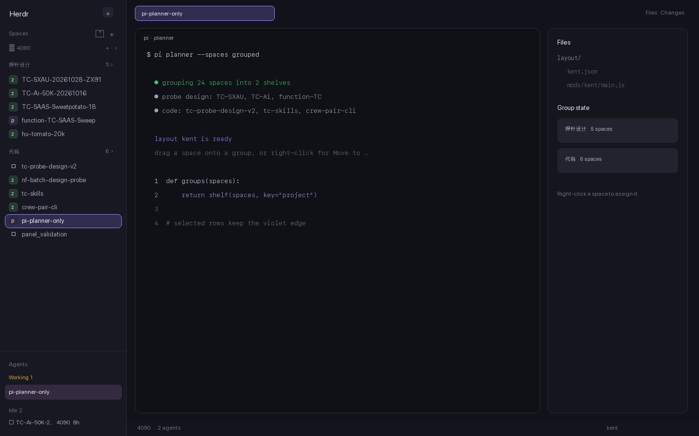

# Kent

A compact dark Herdr layout for people who keep many spaces open. Its Spaces sidebar works like a set of labeled shelves: spaces can be filed under named groups such as “探针设计” and “代码”, while the rest of the window stays close to Herdr's practical main layout.

## What you see

- **The window:** Herdr's main arrangement — sidebar on the left, tab bar over the terminal cards, Files/Changes panel on the right when opened, and a thin status bar.
- **The look:** graphite-dark panels with a quiet violet accent. Important colors are canvas `#12131a`, chrome `#171821`, terminal background `#101117`, border `#292a35`, selected `#302c4d`, and accent `#9a86f3`.
- **The sidebar:** 232px wide by default. The Spaces list receives three shares of the list area and the Agents list two, so a long grouped inventory stays visible.
- **Machines:** when another machine is known, its spaces stay under that machine's header, as in Herdr. Grouping happens inside each machine, never across machines.
- **A group header:** a 24px dim 11px label with the group name, a count, and a chevron. A folded group that contains a blocked or finished agent shows a small status dot.
- **A space row:** 28px high, with an 18px program icon tile, the space name, Herdr's usual repo/branch/ahead/behind tail when useful, and a small dot for blocked or done. The active space is a pill in `selected` with a 1px violet border.
- **Ungrouped spaces:** shown after the groups inside the same machine, without another heading.

## How it behaves

- Click a space to show it. Dragging a space over another row shows the violet insertion line; dropping reorders inside a group or uses Herdr's normal `space.move` behavior for loose spaces.
- Drop a space on a group header to append it to that group. While dragging a grouped space, a “Drop here to ungroup” target appears at the bottom of the list.
- Right-click a space for a keyboard-navigable menu: Open, Rename, No group, one “Move to …” item for each group on that machine, “New group with this space…”, and Close. On git checkouts the same menu also includes Herdr's New/Open/Remove worktree actions.
- Right-click a group to fold/unfold, rename, move it up or down, or delete it. Deleting a group never closes spaces; they simply become ungrouped.
- Click a group header to fold or unfold it. The command palette can also open “New space group” and “Group active space”.
- Groups are per machine. Their names, folded state, membership and in-group order persist in shared state as `kent.groups.v1` and redraw immediately.
- Worktree nesting, machine folding/reconnection, git branch details and the narrow numbered rail are inherited from Herdr's shipped `spaces` mod.
- If `keys.json` is merged, `alt-down` / `alt-up` and `ctrl-shift-pagedown` / `ctrl-shift-pageup` move through spaces in the order Kent draws them, skipping folded rows.

## Built from

- **Layout** `layouts/kent.json`: a copy of Herdr's `main` structure. The sidebar is 232px, the Spaces block uses mod `kent` with weight 3, Agents keeps weight 2, and the root uses `theme: "graphite"` plus the color overrides above.
- **Mod** `mods/kent/`: based on Herdr 0.1.18's shipped `spaces` mod. It keeps the git/worktree/machine logic and adds:
  - the shared group store (`groups`, ordered `in` membership arrays),
  - `machineRows` and `groupHead` rendering,
  - program-icon rows using `panes()` and `program.icon` / `image` / `svg`,
  - drag assignment and in-group ordering,
  - popup menus, group rename/create dialogs, and palette commands through `nextCommand()`.
- **Keys** `keys.json`: optional `layout:kent` bindings for `kent.next` and `kent.prev`.
- **Art:** `preview.png` is a synthetic preview; the layout itself uses Herdr's shipped SVG icons and program icons.

## Watch out

- Group membership is manual: Kent does not infer groups from name prefixes, folders or tags. Use the menu or drag and drop.
- Groups cannot span machines. A group with the same name on two machines is two separate groups.
- The store is local Herdr shared state. It survives restarts of this app, but it is not synchronized to another Herdr client or written into the remote machine's home.
- Ordering inside a group belongs to Kent. Ungrouped spaces still use Herdr's own space ordering.
- In the narrow rail (sidebar below 160px), group labels collapse away and rows use the compact numbered presentation.
- The mod opens its own overlays as `mod: "kent"`; renaming the folder means changing those strings and the layout reference together.
- `herdr-app check` intentionally runs with empty live data, so grouping interactions still need a real-window pass.

## Done when

- New groups can be created from the folder-plus button or command palette, including Chinese names.
- A space can be assigned, moved between groups, reordered in a group and ungrouped; the state survives an app restart.
- Group headers fold, show the right counts, and keep blocked/done visible while folded.
- The active space is the violet pill, and rows show the running program's icon rather than avatar letters.
- Multiple machines still have their own headers and cannot accept cross-machine drops.
- `herdr-app check mods/kent` passes and switching to `layouts/kent.json` produces no entry in `herdr-app status` errors.
